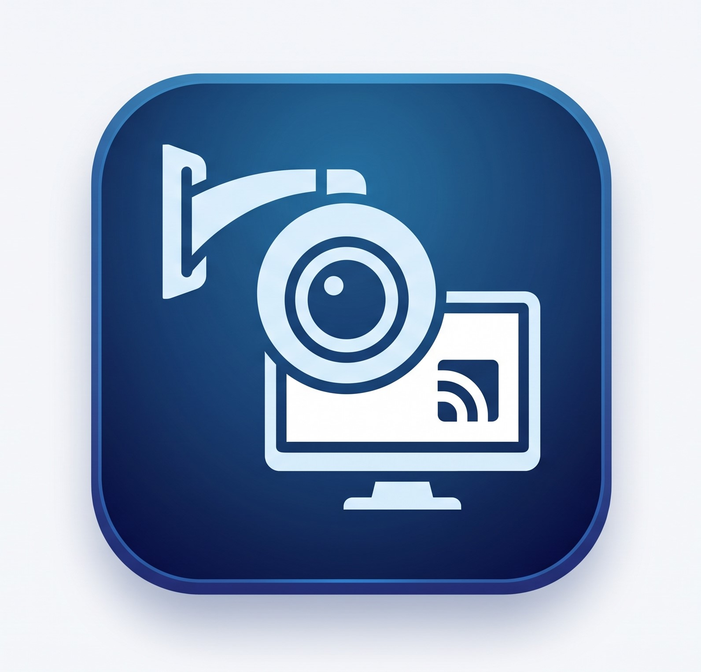

<div align="center">
  
  <h1>WeViewCam</h1>
  <p><strong>A Modern, Unified Video Surveillance & VMS Client Suite for Windows, Linux & Android</strong></p>
  <p><strong>专为 Windows、Linux 桌面与 Android 移动终端打造的现代化视频监控综合管理平台</strong></p>

  <p>
    <a href="#english">English</a> •
    <a href="#中文说明">中文说明</a>
  </p>

  <p>
    
    
    
    
    
    
  </p>
</div>

---

<a name="english"></a>
## 🇬🇧 English

### Overview

**WeViewCam** is an open-source, multi-platform Video Management System (VMS) client suite designed for unified, low-latency surveillance camera monitoring, high-precision PTZ control, and 24-hour timeline video playback across diverse operating systems.

The repository provides tailored editions for desktop and mobile environments:
1. **[WeViewCam_windows](./WeViewCam_windows/)**: Dedicated desktop client for **Windows 10 / 11 (64-bit)** with official Hikvision (`HCNetSDK.dll`) & Dahua (`dhnetsdk.dll` / `dhplay.dll`) Win64 SDK direct rendering (`HWND`).
2. **[WeViewCam_ubuntu](./WeViewCam_ubuntu/)**: Dedicated desktop client for **Ubuntu / Linux x86_64 (20.04 / 22.04 / 24.04)**, deeply optimized for Python 3.12+ / PyQt5 stability with official Linux64 SDK hardware acceleration.
3. **[WeViewCam_android](./WeViewCam_android/)**: Native mobile VMS client for **Android devices**, powered by official Hikvision Android SDK with hardware-accelerated `SurfaceView` rendering.

---

### Project Structure

```text
WeViewCam/
├── WeViewCam_windows/          # Windows 10/11 64-bit Client
│   ├── adapters/               # Hikvision, Dahua & ONVIF/RTSP adapters
│   ├── core/                   # Device management, base adapter & player controller
│   ├── ui/                     # Multi-split live view, PTZ panel & 24h timeline
│   ├── sdk/                    # Official Hikvision & Dahua Win64 SDK DLLs
│   ├── run.bat                 # One-click execution runner
│   ├── pack.py                 # PyInstaller packaging script
│   └── README.md               # Detailed Windows documentation
├── WeViewCam_ubuntu/           # Ubuntu / Linux x86_64 Client
│   ├── adapters/               # Hikvision, Dahua & ONVIF/RTSP adapters
│   ├── core/                   # Device management, base adapter & player controller
│   ├── ui/                     # TreeWidget-based high stability UI & timeline
│   ├── sdk/                    # Official Hikvision & Dahua Linux64 SDK SOs
│   ├── run.sh                  # One-click execution runner (isolated LD_LIBRARY_PATH)
│   ├── package.sh              # Release tarball packager
│   └── README.md               # Detailed Ubuntu documentation
└── WeViewCam_android/          # Android Native Client (Java)
    ├── app/                    # Android Studio application module
    ├── app/build.gradle        # Build script
    └── README.md               # Detailed Android documentation
```

---

<a name="中文说明"></a>
## 🇨🇳 中文说明

### 项目概述

**WeViewCam** 是一款现代化、高性能、多平台视频监控与安防综合管理客户端套件。原生集成海康威视与大华私有 SDK 硬件解码直驱渲染、ONVIF 国际标准协议自动发现与标准 RTSP 流媒体播放。

针对各操作系统的底层视口机制与动态链接库差异，仓库拆分为独立专用的客户端工程：
1. **[WeViewCam_windows](./WeViewCam_windows/)**：**Windows 10/11 64位独立客户端**。支持海康威视与大华 Win64 原生 SDK，HWND 窗口句柄直传硬解加速秒开，支持 PyInstaller 一键便携打包。
2. **[WeViewCam_ubuntu](./WeViewCam_ubuntu/)**：**Ubuntu / Linux x86_64 专用客户端**。针对 Ubuntu 24.04 与 Python 3.12 深度调优，采用 `QTreeWidget` 根治底层的段错误（SIGSEGV），支持 X11 视口直出与大华 PlaySDK 硬件加速流式回放。
3. **[WeViewCam_android](./WeViewCam_android/)**：**Android 移动客户端**。基于 Java 与官方移动端 SDK，支持硬件加速多分屏渲染与触控云台交互。

### 核心特性

- **跨平台多端配置互通**：Windows、Ubuntu 与 Android 各端设备配置格式 100% 互通，支持勾选指定设备导出/导入加密与明文备份。
- **超低延迟硬件直驱渲染**：Windows 端基于 HWND 句柄直传渲染，Linux 端基于 X11 原生直出；支持大华 PlaySDK 硬件流式解码回放。
- **主流厂商全面覆盖**：原生集成海康威视 (HCNetSDK)、大华 (NetSDK / PlaySDK)、ONVIF 国际标准协议及标准 RTSP 协议。
- **主辅码流无缝切换**：实时预览支持高清主码流与流畅子码流一键平滑重载切换。
- **24小时录像精准回放**：支持时间轴拖拽定位、切片双击平滑切换与防抖时序保护。
